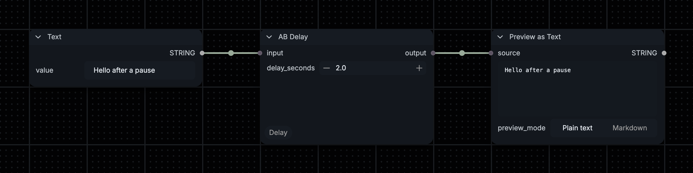

<div align="center">

# AB Delay: pause a workflow for ComfyUI

**Wait a set number of seconds at any point of a graph, then pass the value on unchanged.**

<br />

[](https://github.com/a-und-b/ComfyUI_Delay/stargazers)
&nbsp;
[](https://registry.comfy.org/nodes/delay)
&nbsp;
[](https://registry.comfy.org/nodes/delay)
&nbsp;
[](LICENSE)

<br />



---

Some graphs need a pause: a rate-limited API between two calls, a file another tool writes first, a GPU that should cool down between batches. AB Delay waits the seconds you set, shows a progress bar while it does, and hands its input on untouched.

[Install](#install) · [Example workflow](#example-workflow) · [Usage](#usage) · [Contributing](#contributing)

</div>

---

## Features

| You want | You use |
|----------|---------|
| A pause between two nodes | **AB Delay** between them, `delay_seconds` set |
| Any value to go through unchanged | connect any type to `input` |
| To see how long is left | the progress bar on the node |
| To cancel a long pause | ComfyUI's **Stop** button |

No extra dependencies, no network calls.

## Install

**ComfyUI Manager:** search for **AB Delay**, install, restart ComfyUI.

**comfy-cli:**

```bash
comfy node install delay
```

**Manually:**

```bash
cd ComfyUI/custom_nodes/
git clone https://github.com/a-und-b/ComfyUI_Delay.git
```

Restart ComfyUI. The node appears under **AB/Utils**; search for `AB Delay` or `sleep`.

## Example workflow

[`ab-delay-pause-between-nodes.json`](example_workflows/ab-delay-pause-between-nodes.json): a text goes through **AB Delay** (2 seconds) into **Preview as Text**. Drag the file onto the canvas, or open it in ComfyUI under Workflow → Browse Templates, under the pack's name.

## Usage

1. Put **AB Delay** where the pause belongs and connect any output to its `input`.
2. Set `delay_seconds`.
3. Connect `output` to the next node; it gets the same value after the pause.

The console logs the start and end of each pause:

```
[Delay Node] Starting delay of 1.0 second
[Delay Node] Delay of 1.0 second completed
```

## Contributing

Bug reports and pull requests are welcome. Open an [issue](https://github.com/a-und-b/ComfyUI_Delay/issues) first for larger changes; [`CONTRIBUTING.md`](CONTRIBUTING.md) has the three steps.

Progress bar and cancellation support were contributed by [@obrofg](https://github.com/obrofg) ([#1](https://github.com/a-und-b/ComfyUI_Delay/pull/1)).

## License

[MIT](LICENSE)

---

<div align="center">

Built by [Holger Will](https://github.com/a-und-b) at [anders & besser](https://andersundbesser.de)

<br />

[](https://github.com/a-und-b/ComfyUI_Delay/stargazers)

</div>
